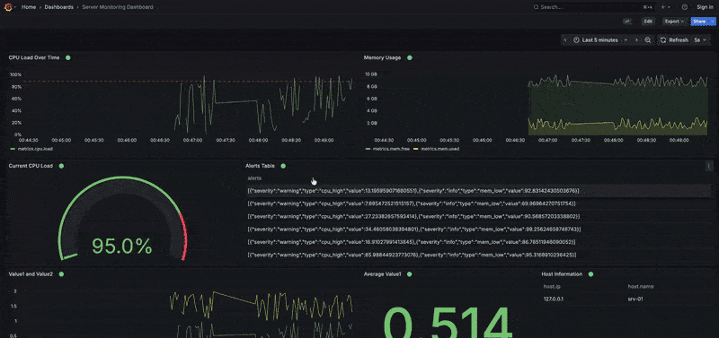

# Kafka Datasource for Grafana

[](LICENSE)
[](https://github.com/hoptical/grafana-kafka-datasource/actions/workflows/ci.yml)
[](https://github.com/hoptical/grafana-kafka-datasource/actions/workflows/release.yml)
[](https://golang.org/doc/go1.26)
[](https://grafana.com)
[](https://www.buymeacoffee.com/hoptical)

---

**Visualize real-time Kafka data in Grafana dashboards.**

---

A Grafana data source plugin that streams Kafka topics into dashboards in real time. It supports JSON, Avro, Protobuf, Plaintext and InfluxDB Line Protocol messages, Schema Registry, SASL (PLAIN, SCRAM, OAUTHBEARER/OIDC, GSSAPI/Kerberos) and SSL/TLS, and Grafana Alerting. Requires Apache Kafka v0.11+ and Grafana v10.2+.

**Features, configuration, querying and format support are documented in the [end-user README](https://github.com/hoptical/grafana-kafka-datasource/blob/main/src/README.md)**, which is also the page shown in the Grafana plugin catalog and inside Grafana.



## Installation

### Via grafana-cli

```bash
grafana-cli plugins install hamedkarbasi93-kafka-datasource
```

### Via zip file

Download the [latest release](https://github.com/hoptical/grafana-kafka-datasource/releases/latest) and unpack it into your Grafana plugins directory (default: `/var/lib/grafana/plugins`).

### Provisioning

You can automatically configure the Kafka datasource using Grafana's provisioning feature. For a ready-to-use template and configuration options, refer to `provisioning/datasources/datasource.yaml` in this repository.

## Sample Data Generator

Want to test the plugin with realistic Kafka messages? Use the included sample producers to generate JSON, Avro, or Protobuf messages with various structures and schema configurations. For detailed usage, see the [example README](https://github.com/hoptical/grafana-kafka-datasource/blob/main/example/README.md). To test Plaintext mode, produce any bytes (for example JSON bytes) and select `Plaintext` in the query editor to view raw payload text.

## Performance Benchmarks

Production builds always use the optimized path. The old pre-fix behavior is still available for measurement through dedicated benchmark variants instead of runtime environment variables.

Useful benchmark pairs:

- `BenchmarkDecodeAvroMessage` vs `BenchmarkDecodeAvroMessage_NoCache`
- `BenchmarkDecodeProtobufMessage_Plain` vs `BenchmarkDecodeProtobufMessage_Plain_NoCache`
- `BenchmarkProcessMessage_JSON_Wide100` vs `BenchmarkProcessMessage_JSON_Wide100_FieldOrderCacheDisabled`
- `BenchmarkWorkflow` vs `BenchmarkWorkflow_NoOptimizations`

Example commands:

```bash
# Run all focused performance benchmarks
go test -run '^$' -bench 'BenchmarkDecodeAvroMessage|BenchmarkDecodeProtobufMessage_Plain|BenchmarkProcessMessage_JSON_Wide100|BenchmarkWorkflow' -benchmem ./pkg/kafka_client/... ./pkg/plugin/...

# Compare cached Avro decode vs the explicit no-cache benchmark path
go test -run '^$' -bench '^BenchmarkDecodeAvroMessage$' -benchmem -count=6 ./pkg/kafka_client/... > after.txt
go test -run '^$' -bench '^BenchmarkDecodeAvroMessage_NoCache$' -benchmem -count=6 ./pkg/kafka_client/... > before.txt
sed 's/BenchmarkDecodeAvroMessage_NoCache/BenchmarkDecodeAvroMessage/' before.txt > before.norm.txt
benchstat before.norm.txt after.txt
```

The Avro and Protobuf schema caches remain bounded with a hardcoded default size of `256` entries. For benchmark methodology, before/after numbers, profiling commands, and architecture notes, see [Performance Optimizations](https://github.com/hoptical/grafana-kafka-datasource/blob/main/docs/PERFORMANCE_OPTIMIZATIONS.md).

## Documentation & Links

- [End-user documentation (usage, configuration, formats, FAQ)](https://github.com/hoptical/grafana-kafka-datasource/blob/main/src/README.md)
- [Sample Producers](https://github.com/hoptical/grafana-kafka-datasource/blob/main/example/README.md)
- [OAuth 2.0 Authentication](https://github.com/hoptical/grafana-kafka-datasource/blob/main/docs/OAUTH2_AUTH.md)
- [Kerberos Authentication](https://github.com/hoptical/grafana-kafka-datasource/blob/main/docs/KERBEROS_AUTH.md)
- [Message Keys](https://github.com/hoptical/grafana-kafka-datasource/blob/main/docs/MESSAGE_KEYS.md)
- [Performance Optimizations](https://github.com/hoptical/grafana-kafka-datasource/blob/main/docs/PERFORMANCE_OPTIMIZATIONS.md)
- [Changelog](https://github.com/hoptical/grafana-kafka-datasource/blob/main/CHANGELOG.md)
- [Contribution Guidelines](https://github.com/hoptical/grafana-kafka-datasource/blob/main/CONTRIBUTING.md)
- [Code of Conduct](https://github.com/hoptical/grafana-kafka-datasource/blob/main/CODE_OF_CONDUCT.md)
- [Articles Series](https://hamedkarbasi.com/series/grafana-kafka-datasource-guides)

---

## Support & Community

If you find this plugin useful, please consider giving it a ⭐ on GitHub or supporting development:

[](https://www.buymeacoffee.com/hoptical)
